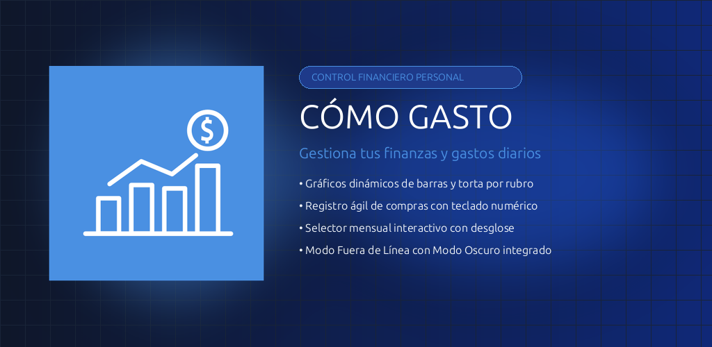
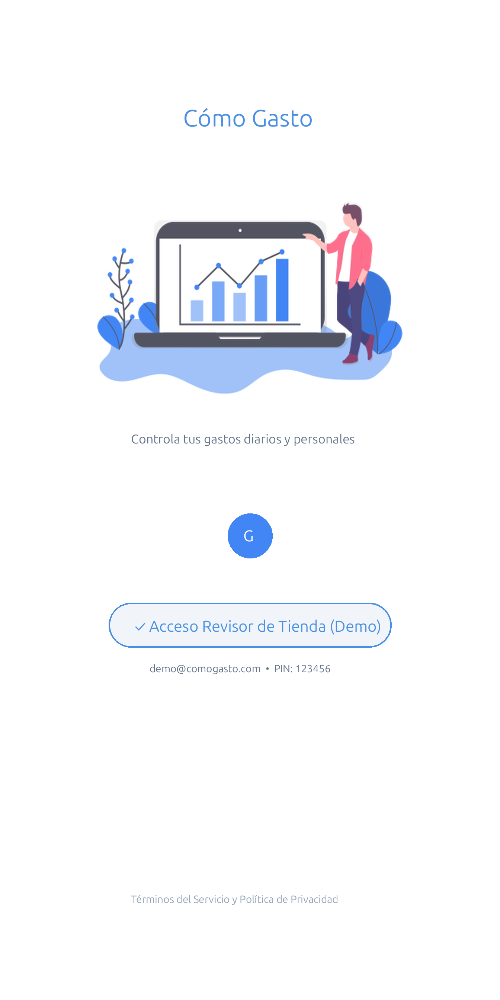
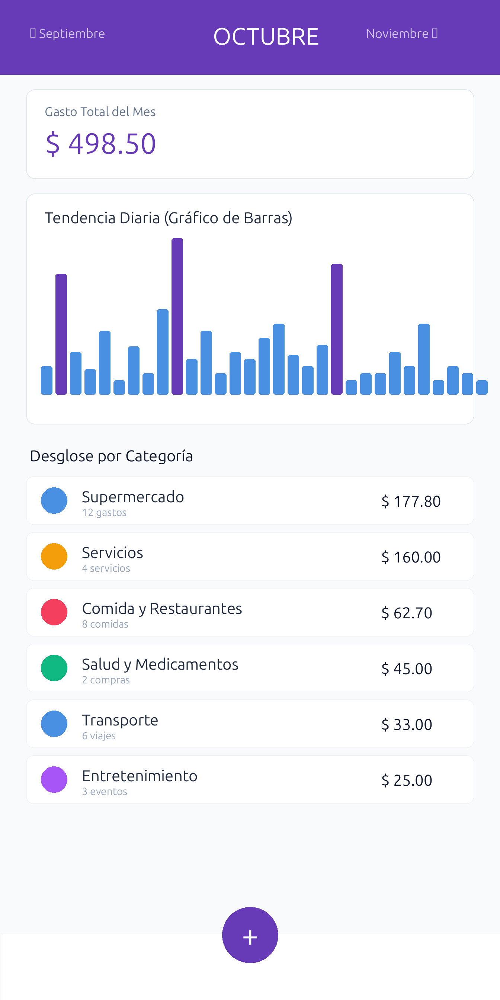
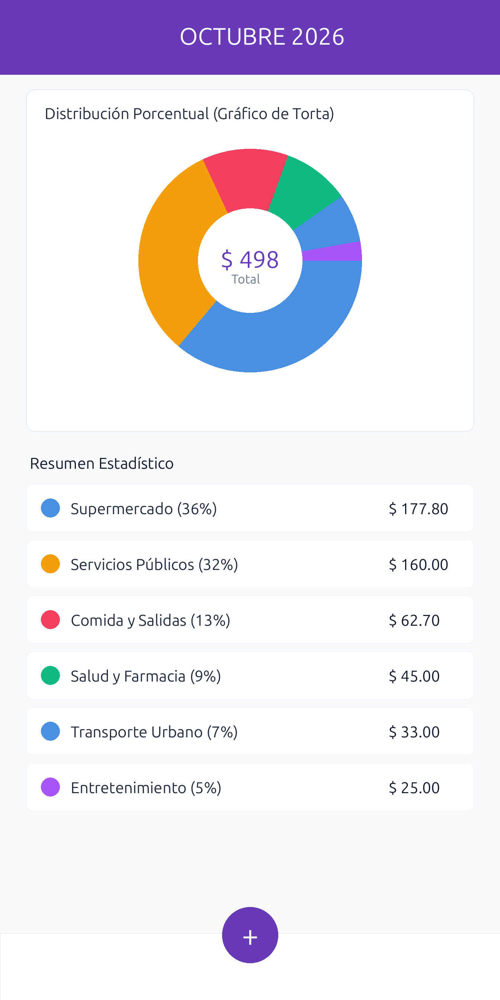
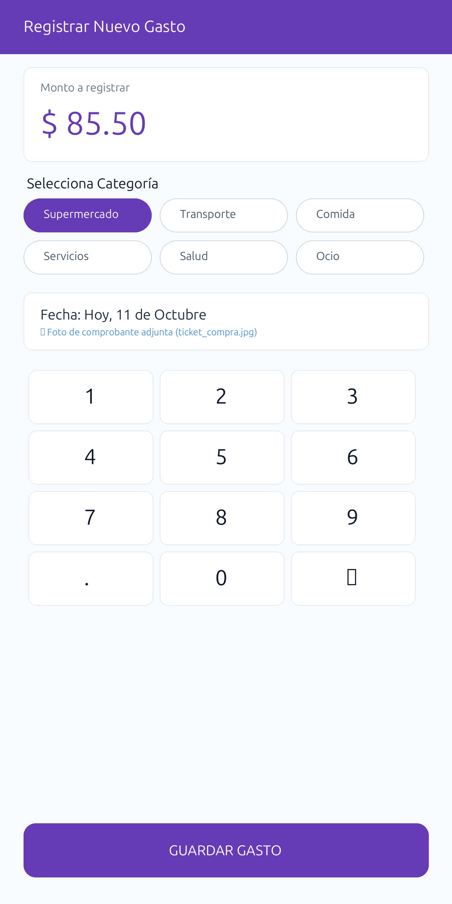
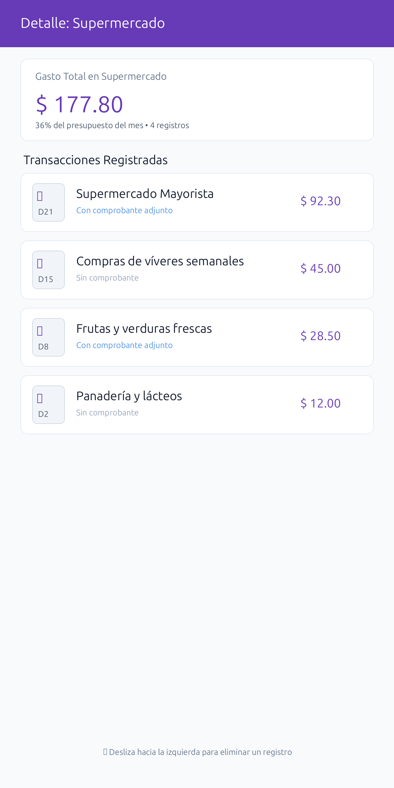
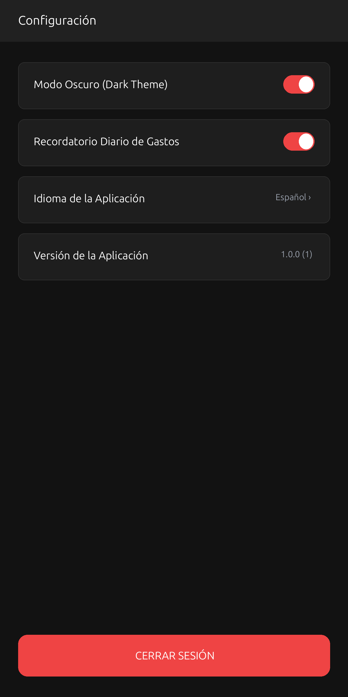

# 📱 Cómo Gasto — Control y Gestión de Finanzas Personales

> **Aplicación móvil ágil, visual y moderna diseñada para llevar el control diario de tus gastos, visualizar estadísticas interactivas y respaldar tus comprobantes de compra.**



---

## 🌟 ¿Qué es Cómo Gasto?

**Cómo Gasto** es una aplicación desarrollada en **Flutter** para usuarios que desean saber con precisión a dónde va su dinero cada mes. Diseñada bajo un enfoque limpio y sin fricción, permite asentar compras en segundos, clasificarlas en categorías claras y entender el balance financiero mediante gráficos intuitivos.

Cuenta con un **Modo Fuera de Línea (Offline)** y **Modo Demostración integrado** para operar de forma autónoma sin depender de conexión a servidores ni registros obligatorios.

---

## 📸 Capturas de Pantalla Oficiales

| 1. Acceso y Bienvenida | 2. Tendencia de Barras | 3. Distribución (Torta) |
|:---:|:---:|:---:|
|  |  |  |

| 4. Registro Rápido | 5. Detalle por Rubro | 6. Modo Oscuro |
|:---:|:---:|:---:|
|  |  |  |

---

## ✨ Características Principales

- ⚡ **Registro Ágil con Teclado Numérico:** Teclado táctil optimizado dentro de la pantalla para ingresar montos en menos de 5 segundos.
- 🏷️ **Categorización Inmediata:** Clasificación por rubros: Supermercado, Transporte, Comida y Salidas, Servicios, Salud y Farmacia, Entretenimiento.
- 📊 **Visualización Gráfica Dual:**
  - **Gráfico de Barras Temporales:** Muestra los días de mayor consumo a lo largo del mes.
  - **Gráfico Circular (Torta):** Muestra el porcentaje que absorbe cada rubro sobre el total mensual.
- 🗓️ **Navegación Mensual Fluida:** Deslizador horizontal (*slider*) para consultar el historial de meses pasados o planificar el mes en curso.
- 🧾 **Respaldo Fotográfico de Recibos:** Captura y adjunta fotos de facturas o tickets físicos mediante cámara o galería.
- 🌙 **Modo Oscuro Integrado:** Interfaz adaptable con tema oscuro de alto contraste para cuidar tu vista y ahorrar batería.
- 🔔 **Recordatorios Diarios Locales:** Notificaciones en el dispositivo que no envían datos a servidores externos.
- 🌐 **Soporte Bilingüe:** Interfaz disponible en Español e Inglés.

---

## 🔑 Cuenta Demo para Evaluación y Pruebas

Para evaluadores de **Google Play Store**, **Apple App Store** o desarrolladores que deseen probar todas las funciones sin configurar Firebase:

1. Inicia la aplicación en cualquier teléfono o emulador.
2. En la pantalla inicial, pulsa el botón: **"Acceso Revisor de Tienda (Demo)"**.
3. Aparecerán las credenciales preconfiguradas:
   - **Correo Demo:** `demo@comogasto.com`
   - **PIN / Clave:** `123456`
4. Presiona **"Ingresar Demo"**. La aplicación cargará inmediatamente transacciones de muestra realistas con gráficos activos y funcionalidad completa.

---

## 🛠️ Stack Tecnológico y Arquitectura

- **Framework:** [Flutter](https://flutter.dev) & [Dart](https://dart.dev)
- **Patrón de Estado:** Provider (`ThemeState`, `LoginState`, `ProxyProvider`)
- **Inyección de Dependencias:** [GetIt](https://pub.dev/packages/get_it)
- **Persistencia:** Cloud Firestore (remoto) + In-Memory Mock Stream (modo demo fuera de línea)
- **Almacenamiento de Archivos:** Firebase Storage + Image Picker
- **Animaciones:** Canvas personalizado + Flare Flutter
- **Gráficos:** Charts Flutter

---

## 🚀 Cómo Ejecutar el Proyecto

### Prerrequisitos
- Tener instalado el SDK de Flutter y Dart.
- Dispositivo Android/iOS conectado o emulador activo.

### Instalación

1. **Clonar el repositorio:**
   ```bash
   git clone https://github.com/telcotronics/como-gasto.git
   cd como-gasto
   ```

2. **Instalar dependencias:**
   ```bash
   flutter pub get
   ```

3. **Ejecutar en modo depuración:**
   ```bash
   flutter run
   ```

---

## 📦 Paquete de Publicación en Tiendas (`store_listing/`)

El proyecto incluye el paquete completo de activos y textos listo para la consola de Google Play y App Store Connect:

- 📄 [**`store_listing/ficha_tienda.md`**](store_listing/ficha_tienda.md): Ficha técnica oficial con nombres, descripciones de marketing, declaraciones legales, tabla de Seguridad de los Datos (Data Safety) y notas de la versión.
- 🔒 [**`store_listing/politica_privacidad.html`**](store_listing/politica_privacidad.html): Política de privacidad estática responsive conforme a GDPR y CCPA.
- 🎨 [**`store_listing/graficos/`**](store_listing/graficos/):
  - `00_icono_512.png`: Ícono 512×512 PNG sin transparencias.
  - `grafico_destacado_1024x500.png`: Banner destacado 1024×500 PNG.
  - `01_login.png` a `06_ajustes.png`: Set de 6 capturas en proporción 2:1 (1344×2688).

---

## 📂 Estructura del Código

```text
lib/
├── main.dart               # Inicialización y configuración de rutas y temas
├── di.dart                 # Configuración de inyección de dependencias
├── expenses_repository.dart# Repositorio de datos (Cloud y Demo Local)
├── states/                 # Manejadores de estado (LoginState, ThemeState)
├── pages/                  # Vistas de la aplicación (Home, Add, Details, Settings, Login)
│   ├── ui/                 # Componentes visuales reutilizables
│   └── notifications/      # Lógica de notificaciones locales
└── others/                 # Widgets auxiliares y visualizadores de gráficos
```

Para una guía técnica detallada de cada módulo, consulta el documento [**`agents.md`**](agents.md) y la carpeta [**`.agente/`**](.agente/).

---

## 📄 Licencia y Créditos
- Desarrollado originalmente por Ricardo Markiewicz ([@gazeria](https://twitter.com/gazeria)).
- Mantenimiento y paquete de publicación oficial por **Telcotronics**.
